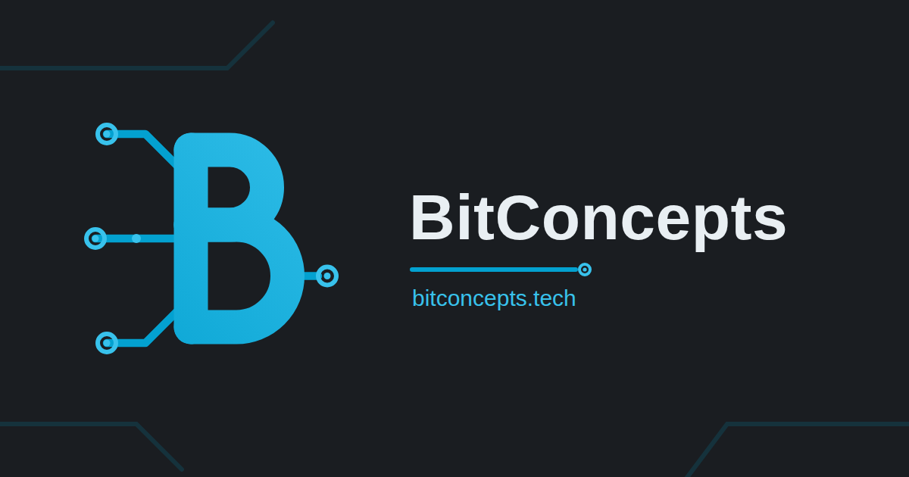

  

<h1 align="center">Engineering and research, held to evidence.</h1>

  Embedded systems R&D · Open research programs · Falsifier-first method

  🌐 <a href="https://bitconcepts.tech"><strong>bitconcepts.tech</strong></a>

BitConcepts, LLC is a Michigan engineering and research studio. We build embedded systems and firmware for industrial products, and we run open research programs designed to be proven wrong — every claim ships with its falsifier, verdicts are pre-registered, and negative results are published next to positive ones.

## What we do

- **Embedded systems & firmware R&D** — product engineering, firmware architecture, and applied research for industrial systems, including Zephyr RTOS and CAN ecosystems.
- **Open research programs** — transparent, reproducible studies with registered predictions, explicit falsifiers, and published negative results.
- **Methods & tooling** — spec-driven development, pre-registered verdict rules, and reproducible artifacts archived with DOIs.
- **Brand & assets** — the canonical BitConcepts identity lives in [BitConcepts/brand-assets](https://github.com/BitConcepts/brand-assets), with a visual gallery at [bitconcepts.github.io/brand-assets](https://bitconcepts.github.io/brand-assets/).

## Built to be proven wrong

BitConcepts runs on an evidence ethos, not a marketing one. Every claim we publish ships with the test that could refute it. Our controls are designed to be able to fail the run — a gate that cannot fail proves nothing. Verdict rules are frozen before outcomes are inspected, negative results are published next to positive ones, and statuses are never rounded up. When our own method failed its held-out test, we said so, in the record, and rebuilt the claim set around what survived.

## How we work

1. **Frame the claim and its falsifier.** If nothing could prove it wrong, it is not a claim yet.
2. **Pre-register the verdict rule before running.** Thresholds, margins, and controls are frozen first.
3. **Run discriminating controls that can fail the run.** Positive and negative controls, or the result does not count.
4. **Publish the result either way, with hashes and DOIs.** Supported, contradicted, inconclusive, invalid — all of them go in the record.
5. **Keep the public record current.** Trackers, registries, and archives are updated as findings confirm.

## Research

BitConcepts research is indexed at [bitconcepts.tech/research](https://bitconcepts.tech/research/), with each program published as a subpage under it. One program is currently listed:

### Glossa-Lab — the Indus script decipherment program

**Program page: [bitconcepts.tech/research/indus-script](https://bitconcepts.tech/research/indus-script/)**

Glossa-Lab is BitConcepts' open computational study of the Indus script. Its current record contains **287 sourced anchors** and a strict core of **94 readings (73.68% coverage)**. **The script is not deciphered.** PRED-2026 is registered and pending.

- Repository: [BitConcepts/glossa-lab](https://github.com/BitConcepts/glossa-lab)
- Archive: [Zenodo concept DOI 10.5281/zenodo.20379070](https://doi.org/10.5281/zenodo.20379070)
- OSF project: [osf.io/ybd65](https://osf.io/ybd65/)

## Selected repositories

- **[glossa-lab](https://github.com/BitConcepts/glossa-lab)** — Glossa-Lab — BitConcepts' Indus decipherment program. Open, falsifier-first computational study: 287 sourced anchors, a strict core of 94 readings (73.68% coverage), PRED-2026 registered. The script is not deciphered.
- **[brand-assets](https://github.com/BitConcepts/brand-assets)** — BitConcepts brand assets — source of truth: logo, palette, and usage guidelines.
- **[bitconcepts-website](https://github.com/BitConcepts/bitconcepts-website)** — bitconcepts.tech — BitConcepts homepage + research site (Cloudflare Pages).
- **[omnican](https://github.com/BitConcepts/omnican)** — OmniCAN: unified multi-protocol CAN stack for Zephyr RTOS — CANopen, CANopen FD, J1939, UDS (ISO 14229), OBD-II (J1979).
- **[arbiter](https://github.com/BitConcepts/arbiter)** — Arbiter: deterministic reasoning and safety-policy engine for Zephyr RTOS. ARB model compiler, fixed-point compute engine, and safety evidence toolkit.

## Consulting

For consulting engagements, see [axiovexsystems.com](https://axiovexsystems.com).

## Contact

- Email: [tpierson@bitconcepts.tech](mailto:tpierson@bitconcepts.tech)
- Web: [bitconcepts.tech](https://bitconcepts.tech)

  <strong>Claims with falsifiers. Results with receipts.</strong>

